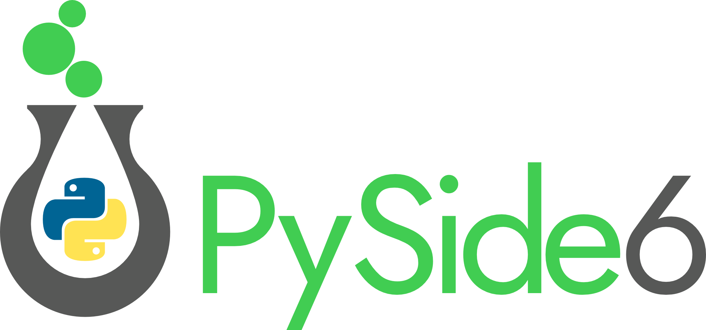
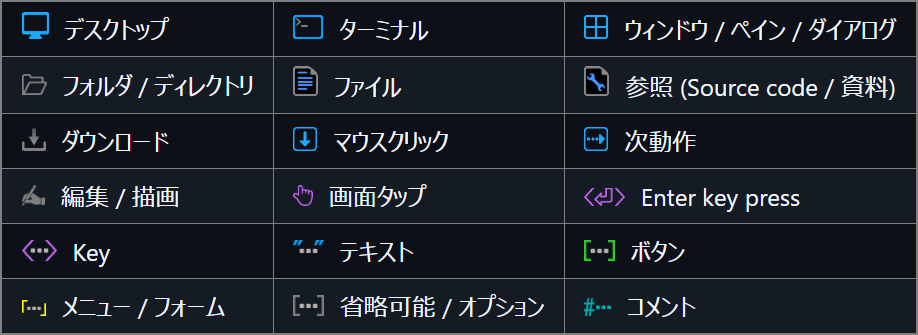
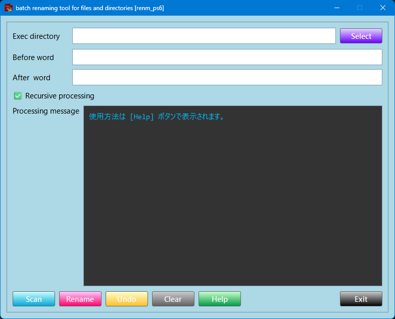
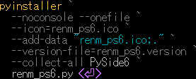
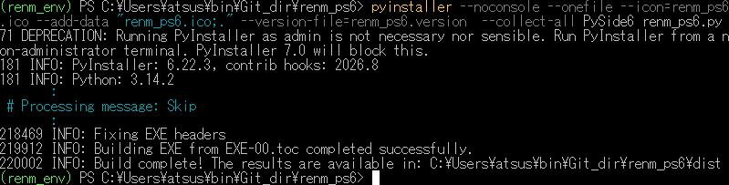

<p akugb=:keft>  
	  
	  
</p>  

# OverView
目的 : PySide6を使用したアプリケーション開発  
内容 : ファイル/ディレクトリ名一括変換ツール[renm_ps6]  
|Item|Content|
|:--|:--|
|OS|　**/**　|  
|Shell|  
|Language||  
|Framework||  
|Editor|　**/**　


> [!caution]
> Trademarks: Company names, product names, and logos used in documents related to this project are trademarks or registered trademarks of their respective owners. They are cited solely for the purpose of describing the technologies used.

> [!NOTE]  
> 凡例  
> [](./assets/env/M_legend.png)  
>
> 縮小画像 (マウスカーソルが  に変化する画像) は  で拡大表示します。  
>
> Source code / コマンド は   でText表示します (表示されたTextの右上にある   でコピー)。  
>
>  ブラウザを **Darkモード** にして頂けると、見やすくなります。  

# ファイル/フォルダーの一括リネームツール [renm]作成手順

## Python 開発環境共通設定  
　　Pythonを使用した開発に関する共通設定を記載しています。  
　　[ **Common settings for the development environment**](https://github.com/AHazeyama/Tkinter_tools/blob/main/CommonSettings.md)

## 開発
### renm_ps6.py コーディング
　[<br>　　 Source code [renm_ps6.py]](https://github.com/AHazeyama/public/blob/main/renm_ps6/renm_ps6.py)  
#### 動作確認
　　/　
<details>  
<summary>  
　  
　  

</summary>   

```PWSH
Python3 renm_ps6.py  
```

</details>  

　　[](./assets/renm_ps6.png)  


### バージョン指定
　renm_ps6.versionを編集  
　GitHub [renm_ps6.version](https://github.com/AHazeyama/renm_ps6/blob/main/renm_ps6.version)

### icon 作成
　renm_ps6.icoを作成  
　解像度：256x256, 128x128, 96x96, 64x64, 48x48, 32x32, 16x16 [pixel] を内包する事  
　　(128,64Pixelは他のサイズで代用可能なため、`.exe`容量を削減する場合は省略可)。  
　GitHub [renm_ps6.ico](https://github.com/AHazeyama/renm_ps6/blob/main/renm_ps6.ico)　
　

　使用ツール　:　 [](https://greenfishsoftware.org/)　　　  

## テスト環境構築  
　  
　
 [mktest.ps1](https://github.com/AHazeyama/renm_ps6/blob/main/mktest.ps1)  

### 試行  
1. ｢**Select**｣ をクリックし、**Exec directory** を選択
2. **not removed words** に**削除除外対象**に含まれる文字列を指定  
3. ｢**Scan**｣ をクリックし、**Prossesing nessage** に表示される削除対象を確認  
複数指定する場合は "**,**" で区切って下さい
4. **☑ Recursive processing** で、下位階層に対する処理の可否を選択 
5. ｢**Delete**｣ をクリックして実行
6. 必要に応じて ｢**Undo**｣ で元に戻す
<br>

## 単体アプリ作成  
　  
<details>  
<summary>  
　  
　  

</summary>   

```PWSH
pyinstaller `
  --noconsole --onefile `
  --icon=renm_ps6.ico `
  --add-data "renm_ps6.ico;." `
  --version-file=renm_ps6.version `
  --collect-all PySide6 `
  renm_ps6.py
```

</details>  

　[](./assets/prtsc/M_MSG_pyinstaller-pyside6-renm.png)  

　出力先  
　　 :　.\ dist \
